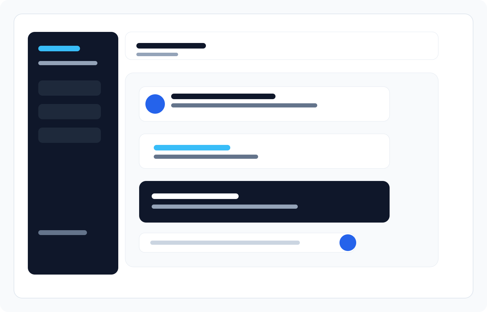

# DocPilot

## Resumo do projeto

O **DocPilot** é uma aplicação web que transforma documentos empresariais em uma base de conhecimento conversacional. A aplicação utiliza Inteligência Artificial para permitir que usuários façam perguntas em linguagem natural e recebam respostas fundamentadas nos documentos previamente enviados.

## O que ele faz

O DocPilot funciona como um assistente inteligente para documentação interna, permitindo:

* upload de arquivos PDF e DOCX;
* processamento e indexação do conteúdo dos documentos;
* recuperação semântica utilizando banco de vetores;
* respostas contextualizadas com IA;
* acesso rápido a informações sem a necessidade de ler documentos completos.

É uma solução indicada para empresas, equipes de suporte, times de produto, departamentos jurídicos e qualquer cenário que envolva documentação extensa.

---

## Screenshot



---

## Tecnologias utilizadas

### Front-end

* Next.js 16
* React 19
* TypeScript
* Tailwind CSS

### Inteligência Artificial

* OpenAI API
* LangChain
* RAG

### Banco de dados vetorial

* Astra DB

### Processamento de documentos

* PDF Parser
* DOCX Parser

### Back-end

* Node.js
* API Routes do Next.js

### Infraestrutura

* Vercel
* GitHub Actions

---

## Arquitetura da aplicação

O fluxo principal da aplicação funciona da seguinte forma:

1. O usuário realiza o upload de um documento.
2. O documento é processado e dividido em trechos.
3. Os embeddings são gerados utilizando IA.
4. Os vetores são armazenados no Astra DB.
5. Quando uma pergunta é realizada, a aplicação busca os trechos mais relevantes.
6. A IA utiliza esse contexto para gerar uma resposta fundamentada.

---

## Keep Alive do Astra DB

O Astra DB possui uma política que pode agendar a exclusão automática de bancos de dados gratuitos após um longo período de inatividade.

Para evitar esse problema, o projeto implementa um mecanismo automático de **Keep Alive**, que mantém o banco ativo sem consumir créditos da OpenAI ou de outros provedores de IA.

### Como funciona

Todos os dias um **GitHub Actions** executa automaticamente uma chamada para a rota protegida:

```text
GET /api/keepalive
```

Essa rota:

* valida uma chave secreta enviada no header (`x-keepalive-secret`);
* realiza apenas uma consulta simples (`findOne`) no Astra DB;
* retorna uma resposta HTTP 200 quando a conexão está funcionando.

Como nenhuma chamada para OpenAI, LangChain ou geração de embeddings é realizada, esse processo **não consome créditos de IA**.

Fluxo da solução:

```text
GitHub Actions
        │
        ▼
/api/keepalive (Vercel)
        │
        ▼
Validação do KEEPALIVE_SECRET
        │
        ▼
Consulta simples no Astra DB
        │
        ▼
HTTP 200 OK
```

---

## Como testar o Keep Alive

### Localmente

```bash
curl -i http://localhost:3000/api/keepalive \
  -H "x-keepalive-secret: seu-segredo"
```

Resposta esperada:

```json
{
  "success": true,
  "message": "Astra DB is alive",
  "timestamp": "..."
}
```

### Produção (Vercel)

```bash
curl -i https://doc-copilot-nine.vercel.app/api/keepalive \
  -H "x-keepalive-secret: seu-segredo"
```

### GitHub Actions

O workflow localizado em:

```text
.github/workflows/keepalive.yml
```

é executado automaticamente todos os dias.

Também é possível executá-lo manualmente:

1. Abra a aba **Actions** do repositório.
2. Selecione **Keep Astra DB Alive**.
3. Clique em **Run workflow**.

Se a rota retornar **HTTP 200**, o workflow será concluído com sucesso.

---

## Segurança

A rota `/api/keepalive` não é pública.

Ela exige autenticação por meio da variável de ambiente `KEEPALIVE_SECRET`, enviada através do header:

```text
x-keepalive-secret
```

Sem essa chave, a rota responde com **HTTP 401 Unauthorized**.

---

## Como validar que não houve consumo de créditos da OpenAI ou Gemini

- A rota /api/keepalive não chama OpenAI, Gemini, LangChain, embeddings nem RAG.
- Ela apenas executa uma leitura simples na coleção do Astra DB.
- Portanto, não deve consumir créditos de OpenAI nem Gemini.

## O que aprendi

Durante o desenvolvimento deste projeto aprofundei conhecimentos em:

* aplicações Full Stack com Next.js;
* integração de IA generativa utilizando OpenAI;
* recuperação semântica com banco de vetores;
* processamento de documentos PDF e DOCX;
* arquitetura de aplicações baseadas em RAG;
* integração com Astra DB;
* deploy de aplicações na Vercel;
* automação de infraestrutura utilizando GitHub Actions;
* gerenciamento seguro de variáveis de ambiente;
* boas práticas para manutenção de aplicações em produção.

---

## Melhorias futuras

Algumas evoluções planejadas para o projeto:

* autenticação de usuários;
* histórico de conversas;
* suporte a mais formatos de documentos;
* múltiplas bases de conhecimento;
* streaming de respostas;
* cache de consultas;
* monitoramento e métricas.

---

## Autora

Desenvolvido por **Julia Sales**.

* GitHub: https://github.com/jsales25
* LinkedIn: https://www.linkedin.com/in/julia-sales-developer

---

<div align="center">
  Feito com 💜 por Julia Sales
</div>
